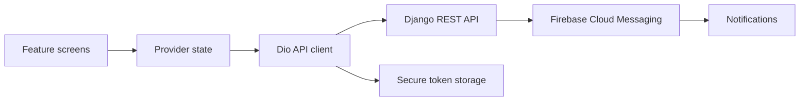

# Mahmood Pharmacy · Customer app

A Flutter storefront for browsing medicines, managing a cart, uploading prescriptions, and following order status. This repository contains the customer-facing application; its companion [Django backend](https://github.com/Imranxhah/MAHMOOD_PHARMACY_BACKEND) supplies the API.

**Flutter · Dart · Provider · Dio · Firebase Cloud Messaging**

[Get started](docs/SETUP.md) · [Architecture](#how-it-fits-together) · [Backend](https://github.com/Imranxhah/MAHMOOD_PHARMACY_BACKEND) · [Contribute](CONTRIBUTING.md)

## Explore the app

| Area | What the code includes |
| --- | --- |
| Browse | Home sections, categories, product details, search, and filters |
| Shop | Cart validation, checkout, saved addresses, and order history |
| Prescriptions | Image upload, prescription history, and contact/address updates |
| Account | Email/OTP flows, password reset, profile editing, and favorites |
| Branches | Branch listing and location-related features |
| Notifications | Firebase messaging, local notifications, and an in-app inbox |
| Appearance | Shared themes and a light/dark mode provider |

Order progress is represented through backend status updates. This repository does not establish a live GPS rider-tracking service.

## Get started

Use a Flutter SDK compatible with **Dart 3.9** and the committed lockfile (Flutter 3.35 or newer).

```bash
git clone https://github.com/Imranxhah/MAHMOOD_PHARMACY_CUSTOMER_APP.git
cd MAHMOOD_PHARMACY_CUSTOMER_APP
flutter pub get
```

Before running, complete the [configuration guide](docs/SETUP.md):

1. Run your own backend and update the API and media URLs.
2. Configure a Firebase project for the target platform.
3. Connect an Android device or emulator, then run:

```bash
flutter devices
flutter run -d <device-id>
```

The checkout includes platform folders for mobile, web, and desktop. They are not a guarantee of platform readiness: Firebase startup and native plugins require platform-specific setup. Start with Android.

## How it fits together



The API client adds bearer tokens and attempts a refresh after eligible authentication failures. Providers expose application state to feature screens.

| Location | Responsibility |
| --- | --- |
| [lib/main.dart](lib/main.dart) | Firebase startup, provider registration, app theme |
| [lib/src/features](lib/src/features) | Screens grouped by user workflow |
| [lib/src/providers](lib/src/providers) | Authentication, catalog, cart, orders, and other state |
| [lib/src/api/api_client.dart](lib/src/api/api_client.dart) | REST requests and token refresh |
| [lib/src/models](lib/src/models) | API data models |
| [lib/src/constants/api_constants.dart](lib/src/constants/api_constants.dart) | Platform API URLs and media origin |

## Development notes

- Run `flutter analyze` after changing Dart code.
- The current widget test is commented out; there is no meaningful automated UI coverage yet.
- Notification-tap navigation includes an unfinished order-details path in `lib/main.dart`.
- The launcher-icon configuration refers to `assets/app_icon/icon.png`, while the checked-in asset is `ic_launcher.png`. Correct that path before regenerating icons.
- Android release builds currently use debug signing. Configure release signing before distribution.

See [setup and troubleshooting](docs/SETUP.md) for connection and Firebase issues. The cover is original illustrative artwork, not an application screenshot.

## Contributing

Found a reproducible issue or a useful improvement? Read the [contribution guide](CONTRIBUTING.md), then open an issue with the screen, expected behavior, and steps to reproduce.

No license file is included in this repository. Contact the owner to clarify reuse terms.

Built by [Imran Shah](https://github.com/Imranxhah).
